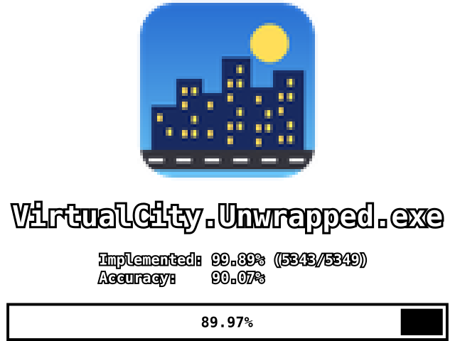
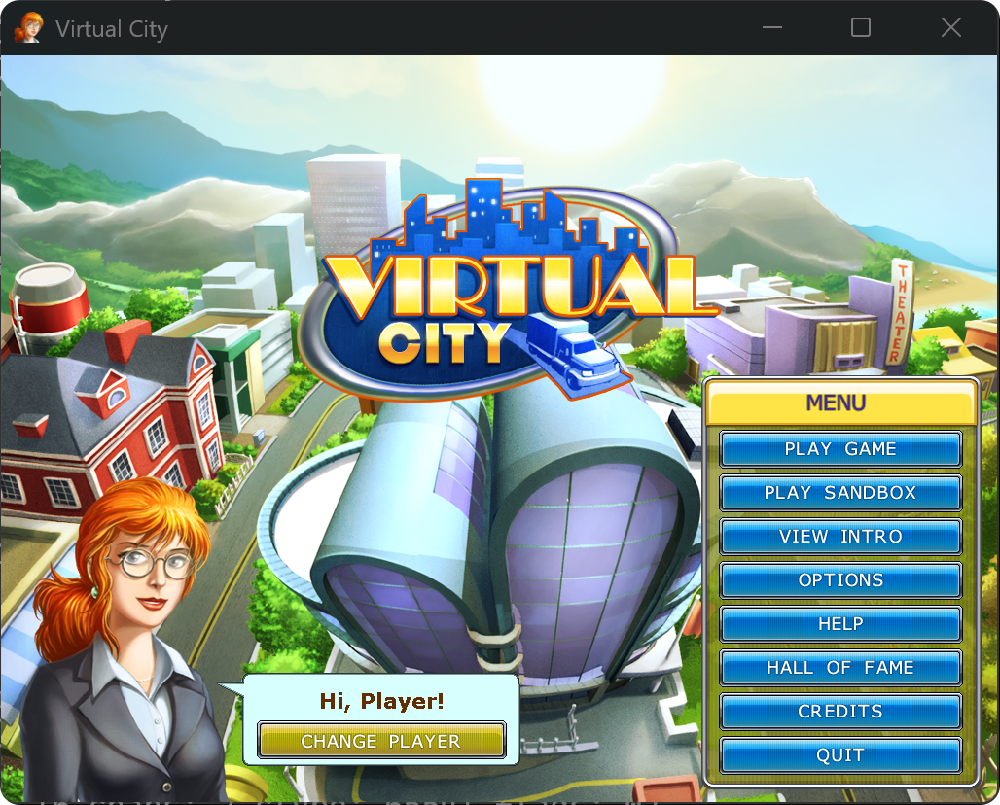
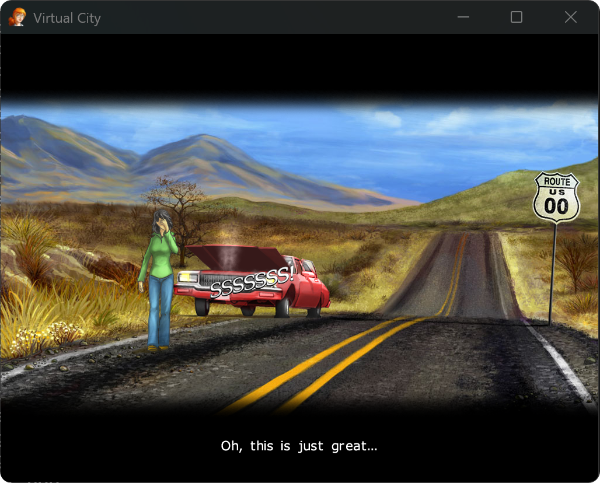
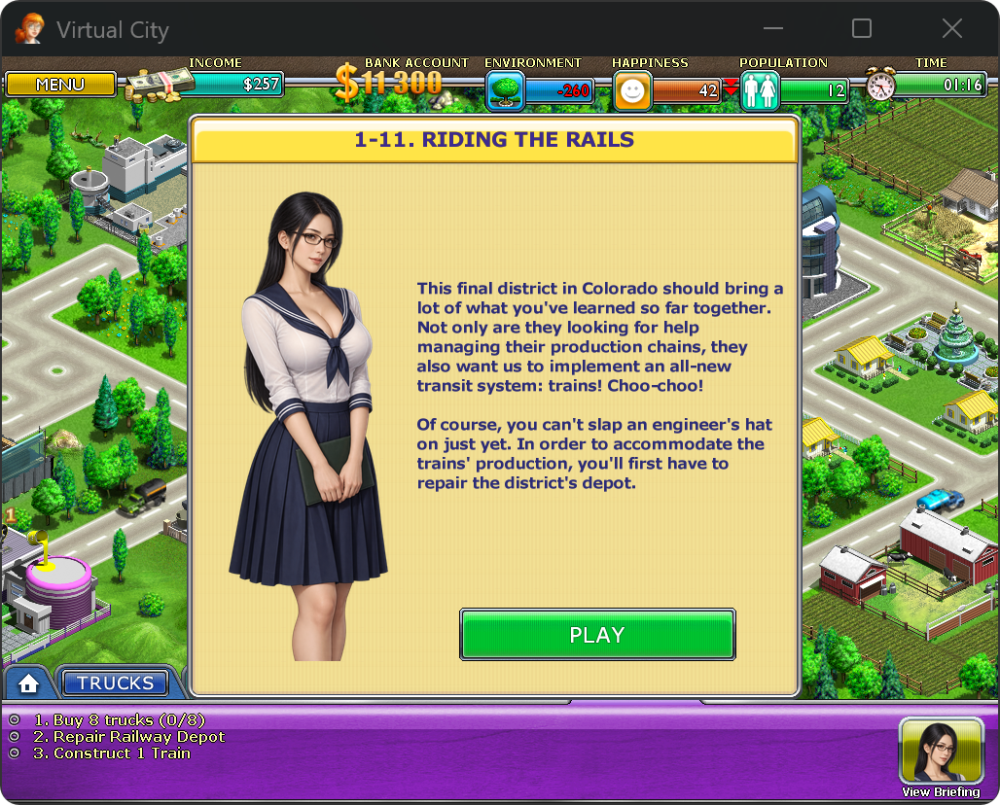
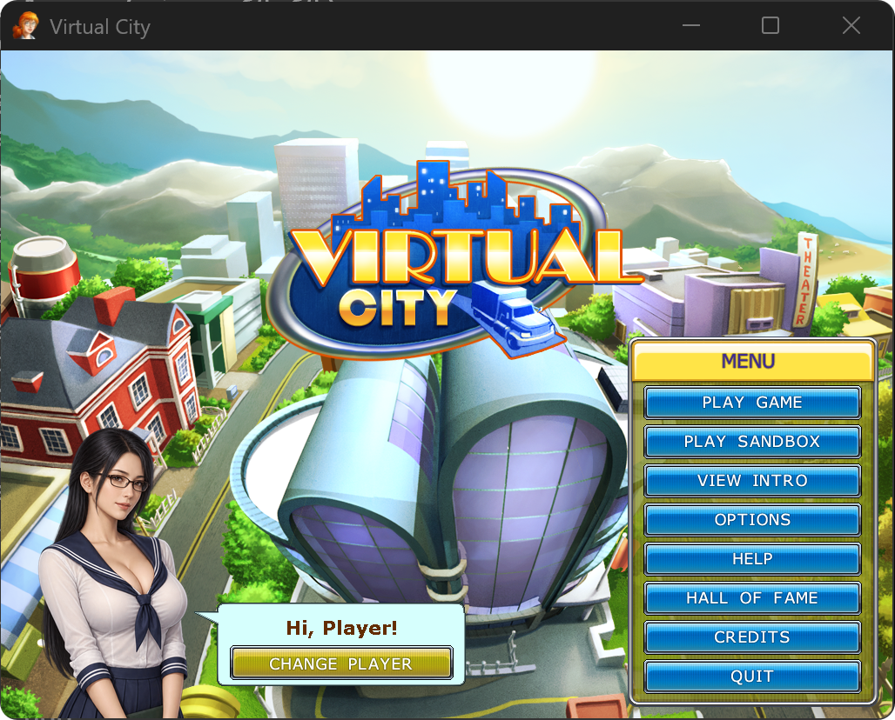

<p align="center">
  
</p>

<h1 align="center">Virtual City decomp</h1>

<p align="center">
  A playable decompilation of G5 Entertainment's <i>Virtual City</i> (2009), rebuilt from recovered C++ with
  Visual C++ 2008 SP1 and matched function by function against the original executable with
  <a href="https://github.com/isledecomp/reccmp">reccmp</a>.
</p>

## Showcase

<table>
  <tr>
    <td width="50%"></td>
    <td width="50%"></td>
  </tr>
  <tr>
    <td align="center">Main menu, rendered by the recovered display and tile code</td>
    <td align="center">Intro comic: JPEG backgrounds and Pyro particles (the steam from the car)</td>
  </tr>
  <tr>
    <td width="50%"></td>
    <td width="50%"></td>
  </tr>
  <tr>
    <td align="center">In a level: the city, HUD, transports and the briefing for 1-11</td>
    <td align="center">Texture mods: the advisor portrait replaced by a PNG mod</td>
  </tr>
</table>

## Status

- **Playable:** campaign and sandbox run from the recompiled executable, with graphics, particles, music and sound.
- **Matching:** 5342 of the original's 5348 functions are recovered in source, and 3149 of them compile to identical bytes. The average function is 90% similar (the badge's "accuracy"); weighted by size it is 77%, and 31% of the code bytes already match exactly. These are per-function assembly comparisons, not a measure of how much of the game works.
- **Two builds from one source tree:**
  - The reference build uses the original toolchain and the real Windows DLLs, and is the one compared with reccmp.
  - The SDL3 build reimplements those DLLs over SDL3 and SDL3_mixer, for modern compilers.

The original game is not included. You need your own copy, placed at `Virtual-City_Win_EN_Full/VirtualCity.Unwrapped.exe`, with SHA-256 `bdc3bc9f075a813d12078fd2eaaaa1131ba74616b11aa1444cdd5a5b83e08695`.

## Quick start

```powershell
git clone --recursive https://github.com/w43322/vc1.git
cd vc1
.\tools\setup-reccmp.ps1        # Python venv, reccmp, local config
.\tools\build-vc9.cmd           # reference build (needs VC9 SP1)
.\tools\compare-reccmp.ps1      # match report in build\vc9\reports\
```

Play the recompiled game from the game data folder, or through the debug runner:

```powershell
.\.venv\Scripts\python.exe tools\run-debug.py --timeout 60 --keep
```

For the SDL3 build (Visual Studio 2017 or newer, Ninja; SDL is downloaded into `build\`):

```powershell
.\tools\build-sdl3.cmd          # build\sdl3\bin\VirtualCity.SDL3.exe
```

## Requirements

- Visual Studio 2008 SP1 (VC9) x86 for the reference build; set `VC9_ROOT` if it isn't in the default location.
- Python 3.10+ and CMake 3.13+.
- For decompiling: Ghidra 12.x and, optionally, a ghidra-mcp checkout (the `bridge-mcp-ghidra` uv project) for agents. Set their paths once:

```powershell
setx VC1_GHIDRA_HOME "C:\tools\ghidra_12.1.2_PUBLIC"
setx VC1_GHIDRA_MCP_DIR "C:\tools\ghidra-mcp"
.\tools\setup-mcp.ps1           # writes the local .mcp.json
.\tools\init-ghidra.ps1         # first-time Ghidra project and analysis
```

## Working on the decomp

Each recovered function is written from Ghidra evidence and checked against the original with reccmp. The rules (markers, ABI, library patches, workflow) are in [AGENTS.md](AGENTS.md); the main tools are:

| Command | Purpose |
| --- | --- |
| `tools\compare-reccmp.ps1` | Full report; `-ResetBaseline` starts a round, `-UpdateStatus` refreshes `docs\status.svg` |
| `tools\diff-reccmp.ps1 0x00486b00` | Assembly diff of one function |
| `tools\stackcmp-reccmp.ps1 0x00486b00` | Stack-slot comparison |
| `tools\open-ghidra.ps1` / `close-ghidra.ps1` / `import-ghidra.ps1` | Ghidra session and name import |
| `tools\decompile-nut.ps1` | Readable copies of the game's compiled Squirrel scripts |

Third-party code is vendored under `third_party/`: Squirrel 2.2.3, SqPlus, libpng 1.0.2, zlib 1.1.3, jpgd 0.93b, libtga, the LZMA SDK 4.57, Boost 1.41 pool, pthreads-win32 2.8.0 and klibc's scanf. The decompiler and reccmp are submodules in `vendor/`.

## Mods

The SDL3 build can replace game artwork with PNGs. A mod is a folder in the git-ignored `mods/` directory with a `mod.json`:

```json
{"id":"advisor","version":"4.0","tiles":{"SCORING_FULL_GIRL_01":"textures/advisor.png"}}
```

`mods/enabled.txt` lists the active mods; `tools\mod-tiles.py NAME` prints a tile's size and position. Mods never modify the game's files.

## Legal

This project contains no game assets. The screenshots illustrate the recompiled build running on the author's copy of the game. *Virtual City* is © G5 Entertainment.
